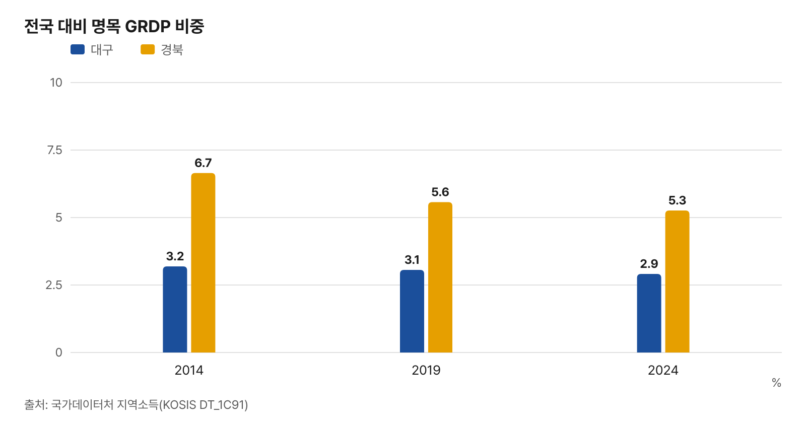
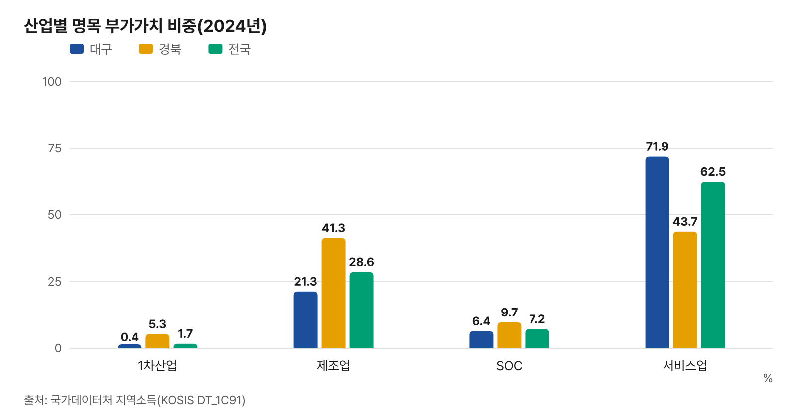
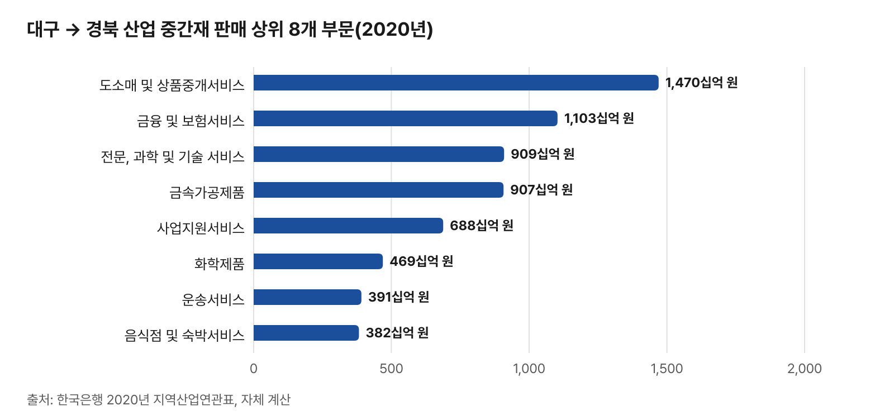
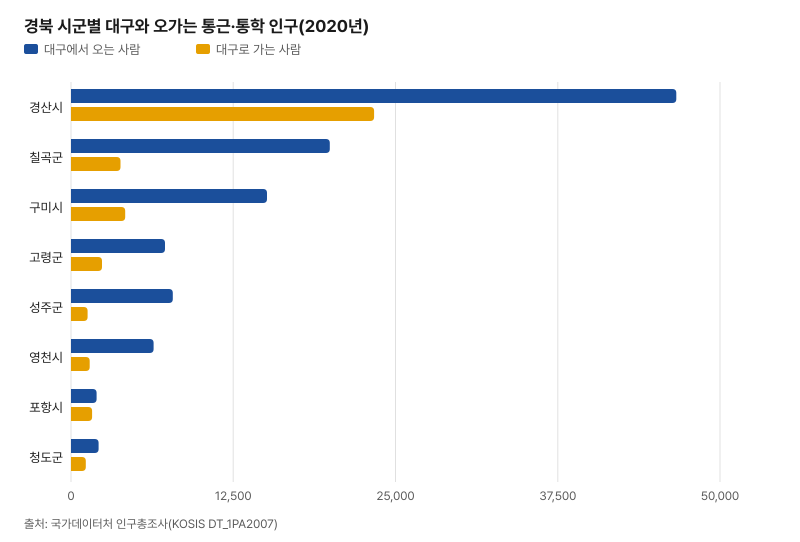

# 대구·경북 제조업과 서비스업 연계성 — 최신 공개 통계로 다시 계산

- 2016년 2월 한국은행 대구경북본부가 낸 「대구경북지역의 제조업과 서비스업간 연계성 분석」(산업연구원·한국은행 대구경북본부 공동 연구)의 분석 틀(거시·산업구조 → 비교우위 산업 → 산업연관 네트워크)을 따라 지금 공표된 통계로 다시 계산한 자료
- 원 보고서의 정책 제언과 해석 문장은 옮기지 않았다. 숫자는 공표 통계 값과 그 나눗셈·뺄셈만 적었고, 좋고 나쁨을 가리는 표현은 쓰지 않았다
- 원 보고서에 없던 사람·기업·거래 연결(통근·통학, 대구 기업의 경북 공장, 지역 간 산업 거래)을 Ⅴ장으로 더했다

## 요약

- 경제 규모: 2024년 명목 지역내총생산(GRDP) 비중 대구 2.91%, 경북 5.26% — 2014년보다 각각 -0.28%p, -1.39%p
- 성장: 2014→2024년 실질 GRDP 연평균 성장률 대구 1.41%, 경북 0.28%, 전국 2.52%
- 1인당 GRDP(2024년, 전국 = 100): 대구 63.1, 경북 106.4
- 산업구조(2024년 명목 부가가치): 대구 제조업 21.3%·서비스업 71.9%, 경북 제조업 41.3%·서비스업 43.7%
- 고용 변화(2020→2024년, 전국사업체조사 종사자): 대구 제조업 -13,831명·서비스업 +39,580명, 경북 제조업 -2,613명·서비스업 +53,871명
- 비교우위 산업(사업체·종사자 입지계수 1 이상 + 지역산업특화효과 양수): 대구 9개, 경북 19개 중분류 — 두 지역 모두에 든 업종은 섬유제품 제조업; 의복 제외, 자동차 및 트레일러 제조업
- 산업연관 네트워크(2020년 지역산업연관표, 33부문): 유효 연결(보정 생산유발계수 0.03 이상) 비율 대구 4.5%, 경북 5.8%, 대경권 3.0% — 대경권 유효 연결 129개 가운데 대구↔경북을 잇는 연결은 19개
- 지역 간 거래(2020년): 대구 산업이 국내에서 사들인 중간재 중 경북산 9.5%, 경북 산업이 사들인 중간재 중 대구산 7.1%
- 대구 기업의 경북 공장: 회사 이름과 생산품이 함께 맞는 곳 157개 회사·174개 공장(이름만 맞는 곳까지 넓히면 1,159개 회사) — 경산·칠곡·구미·성주 순

## Ⅰ. 분석 틀과 자료

### 원 보고서와 달라진 점

| 구분 | 원 보고서(2016-02) | 이번 계산 |
|---|---|---|
| 지역소득(GRDP) | 2001 – 2014년 | 2014 – 2024년(2024년은 잠정) |
| 사업체·종사자 | 전국사업체조사 2007 – 2014년 | 전국사업체조사(등록기반, 11차 분류) 2020 – 2024년 |
| 비교우위 판정의 성장 기준 | 고용·매출 변이할당 | 고용 변이할당(시도·중분류 매출 공표 자료 없음) + 제조업은 광업·제조업조사 출하액 참고 |
| 산업연관표 | 2005·2013년 지역산업연관표, 48부문 | 2020년 지역산업연관표(지역간 투입산출표), 33부문 |
| 네트워크 연결 기준 | 보정 생산유발계수 0.03 이상 | 같음(0.03 이상) |
| 더한 내용 | — | 통근·통학(인구총조사), 대구 기업의 경북 공장(공장등록), 지역 간 중간재·최종수요 거래(산업연관표) |

- 부문 수가 48개에서 33개로 줄어 유효 연결 비율·중앙성 값은 원 보고서 값과 직접 견주지 않는다
- 2020년은 코로나19 첫해라 산업연관표의 거래 구조에 그해 수요 변화가 들어 있다
- 이번에 쓴 전국사업체조사 표(등록기반, 11차 분류)는 2020년부터라 그 전 해 값과 잇지 않았다

## Ⅱ. 대경권 경제와 산업구조

### 지역내총생산(GRDP) 규모·성장

| 시도 | 명목 비중 2014 | 2019 | 2024 | 변화(%p) | 실질 성장률 2014–2019 | 2019–2024 | 2014–2024 | 실질 증가 기여율 |
|---|---|---|---|---|---|---|---|---|
| 전국 | 100.00 | 100.00 | 100.00 | 0.00 | 3.00 | 2.04 | 2.52 | 100.0 |
| 서울특별시 | 22.28 | 22.81 | 22.46 | 0.17 | 3.28 | 1.62 | 2.44 | 21.9 |
| 부산광역시 | 5.05 | 4.87 | 4.73 | -0.32 | 2.17 | 1.32 | 1.74 | 3.4 |
| 대구광역시 | 3.19 | 3.06 | 2.91 | -0.28 | 1.80 | 1.02 | 1.41 | 1.7 |
| 인천광역시 | 4.63 | 4.66 | 4.90 | 0.27 | 2.91 | 3.53 | 3.22 | 6.3 |
| 광주광역시 | 2.15 | 2.17 | 2.14 | -0.01 | 2.78 | 2.03 | 2.41 | 2.1 |
| 대전광역시 | 2.18 | 2.20 | 2.20 | 0.02 | 2.75 | 2.12 | 2.43 | 2.1 |
| 울산광역시 | 4.48 | 3.67 | 3.67 | -0.81 | -0.96 | 1.71 | 0.36 | 0.6 |
| 세종특별자치시 | 0.54 | 0.65 | 0.68 | 0.13 | 6.47 | 2.66 | 4.55 | 1.1 |
| 경기도 | 22.65 | 24.72 | 25.44 | 2.79 | 4.95 | 3.28 | 4.11 | 39.3 |
| 강원특별자치도 | 2.43 | 2.51 | 2.52 | 0.10 | 3.39 | 1.36 | 2.37 | 2.3 |
| 충청북도 | 3.22 | 3.73 | 3.58 | 0.36 | 6.08 | 1.18 | 3.60 | 4.8 |
| 충청남도 | 6.05 | 5.88 | 5.88 | -0.17 | 3.20 | 2.12 | 2.66 | 6.2 |
| 전북특별자치도 | 2.89 | 2.70 | 2.61 | -0.28 | 1.32 | 0.99 | 1.16 | 1.3 |
| 전라남도 | 4.30 | 3.91 | 4.06 | -0.24 | 1.22 | 1.57 | 1.40 | 2.3 |
| 경상북도 | 6.65 | 5.57 | 5.26 | -1.39 | -0.10 | 0.66 | 0.28 | 0.7 |
| 경상남도 | 6.32 | 5.80 | 5.91 | -0.41 | 1.11 | 1.19 | 1.15 | 2.8 |
| 제주특별자치도 | 0.99 | 1.09 | 1.05 | 0.06 | 4.64 | 1.09 | 2.85 | 1.2 |

- 단위: %. 명목 비중 = 시도 명목 GRDP ÷ 17개 시도 합. 실질 성장률은 기간 연평균. 실질 증가 기여율 = 시도 실질 GRDP 증가분 ÷ 17개 시도 증가분 합
- 원 보고서의 2014년 명목 비중은 대구 3.14%, 경북 6.17%였다. 이번 표의 2014년 값(3.19%, 6.65%)은 지금 KOSIS 에 공표된 값으로, 원 보고서를 쓸 때의 값과 다르다
- 자료: 국가데이터처 지역소득(KOSIS DT_1C91)

### 1인당 GRDP·인구

| 지역 | 1인당 GRDP 2014(백만 원) | 2024(백만 원) | 2024 전국 = 100 | 인구 2014 | 인구 2024 | 인구 증감 |
|---|---|---|---|---|---|---|
| 전국 | 32.0 | 50.0 | 100.0 | 51,327,916 | 51,217,221 | -110,695 |
| 대구광역시 | 21.0 | 31.5 | 63.1 | 2,493,264 | 2,363,629 | -129,635 |
| 경상북도 | 40.4 | 53.2 | 106.4 | 2,700,794 | 2,531,384 | -169,410 |

- 1인당 GRDP = 명목 GRDP ÷ 주민등록 연말 총인구. 원 보고서의 2014년 대구 값은 전국 대비 64.3%(명목)
- 자료: 국가데이터처 지역소득, 행정안전부 주민등록인구현황(KOSIS)

| 지역 | 2020년 | 2023년 | 2025년 |
|---|---|---|---|
| 전국 | 16.4 | 19.0 | 21.2 |
| 대구광역시 | 16.6 | 19.6 | 22.1 |
| 경상북도 | 21.7 | 24.7 | 27.5 |

- 고령인구비율(65세 이상 ÷ 전체, %). 자료: 국가데이터처 e-지방지표(KOSIS DT_1YL20631)

### 고용·노동생산성

| 지역 | 취업자 2014(천 명) | 2019 | 2025 | 고용률 2014 | 2019 | 2025 | 15–64세 고용률 2025 | 실업률 2025 |
|---|---|---|---|---|---|---|---|---|
| 전국 | 25,897.2 | 27,122.7 | 28,768.9 | 60.5 | 60.9 | 62.9 | 69.8 | 2.8 |
| 대구광역시 | 1,226.6 | 1,219.2 | 1,214.1 | 58.7 | 57.9 | 58.0 | 65.7 | 3.3 |
| 경상북도 | 1,441.3 | 1,430.1 | 1,478.5 | 63.2 | 61.7 | 64.8 | 70.0 | 2.6 |

| 지역 | 노동생산성 2014(백만 원) | 노동생산성 2019(백만 원) | 노동생산성 2024(백만 원) | 2024 전국 = 100 |
|---|---|---|---|---|
| 전국 | 63.3 | 75.3 | 89.6 | 100.0 |
| 대구광역시 | 42.6 | 51.3 | 61.3 | 68.4 |
| 경상북도 | 75.7 | 79.6 | 92.1 | 102.8 |

- 노동생산성 = 명목 GRDP ÷ 취업자(같은 해, 원 보고서 <표 7>과 같은 정의)
- 자료: 국가데이터처 경제활동인구조사(연간), 지역소득

| 지역 | 제조업종사자 2020 | 1인당급여 2020 (백만 원) | 제조업종사자 2024 | 1인당급여 2024 (백만 원) |
|---|---|---|---|---|
| 전국 | 2,910,361 | 47.6 | 3,037,018 | 56.8 |
| 대구광역시 | 101,574 | 39.5 | 100,330 | 48.6 |
| 경상북도 | 234,370 | 50.2 | 243,021 | 60.5 |

- 제조업(10인 이상 사업체) 1인당 연간 급여 = 연간 급여액 ÷ 종사자 수(자영업자·무급가족종사자 포함). 자료: 국가데이터처 광업·제조업조사(KOSIS DT_1FS1109)

### 산업별 부가가치 비중

| 지역 | 구분 | 명목 2014 | 2019 | 2024 | 실질 2014 | 2019 | 2024 |
|---|---|---|---|---|---|---|---|
| 대구광역시 | 1차산업 | 0.3 | 0.2 | 0.4 | 0.3 | 0.3 | 0.4 |
| 대구광역시 | 제조업 | 22.9 | 21.1 | 21.3 | 22.5 | 21.0 | 19.7 |
| 대구광역시 | SOC | 5.6 | 5.8 | 6.4 | 6.1 | 5.9 | 6.0 |
| 대구광역시 | 서비스업 | 71.3 | 72.9 | 71.9 | 71.1 | 72.8 | 73.7 |
| 경상북도 | 1차산업 | 5.5 | 5.1 | 5.3 | 5.8 | 5.6 | 5.1 |
| 경상북도 | 제조업 | 53.8 | 45.2 | 41.3 | 50.5 | 44.2 | 40.7 |
| 경상북도 | SOC | 8.3 | 8.6 | 9.7 | 9.1 | 9.0 | 10.2 |
| 경상북도 | 서비스업 | 32.4 | 41.2 | 43.7 | 33.8 | 41.2 | 44.3 |
| 전국 | 1차산업 | 2.3 | 1.8 | 1.7 | 2.4 | 1.9 | 1.7 |
| 전국 | 제조업 | 30.7 | 28.6 | 28.6 | 29.2 | 28.3 | 28.7 |
| 전국 | SOC | 6.7 | 7.2 | 7.2 | 7.2 | 7.4 | 6.3 |
| 전국 | 서비스업 | 60.3 | 62.5 | 62.5 | 61.1 | 62.4 | 63.0 |

- 단위: 총부가가치(기초가격) 대비 %. 1차산업 = 농림어업 + 광업, SOC = 전기·가스·증기 + 건설, 서비스업 = 지역소득의 서비스업 묶음(수도·하수·폐기물 처리 포함). 네 묶음의 명목 합이 총부가가치와 같음을 확인했다
- 실질 비중은 연쇄가격이라 합이 100이 되지 않을 수 있다
- 원 보고서 2014년 값: 대구 제조업 22.3%·서비스업 71.5%, 경북 제조업 48.8%·서비스업 37.2%(명목)

| 업종 | 대구 2014 | 대구 2024 | 경북 2014 | 경북 2024 | 전국 2024 | 입지계수 대구 | 경북 |
|---|---|---|---|---|---|---|---|
| 음식료품 및 담배제조업 | 0.8 | 0.8 | 1.5 | 1.6 | 1.5 | 0.54 | 1.10 |
| 섬유 의복 및 가죽 제품 제조업 | 3.4 | 1.7 | 1.6 | 1.1 | 0.7 | 2.41 | 1.51 |
| 목재종이인쇄 및 복제업 | 1.1 | 1.0 | 0.6 | 0.6 | 0.7 | 1.47 | 0.93 |
| 석탄 및 석유 화학제품 제조업 | 1.9 | 2.1 | 4.0 | 4.4 | 5.1 | 0.42 | 0.87 |
| 비금속광물 및 금속제품 제조업 | 5.3 | 5.0 | 12.0 | 11.5 | 4.3 | 1.16 | 2.68 |
| 전기 전자 및 정밀기기 제조업 | 3.3 | 3.9 | 28.7 | 15.2 | 9.5 | 0.41 | 1.61 |
| 기계 운송장비 및 기타 제품 제조업 | 6.9 | 6.8 | 5.5 | 6.8 | 7.0 | 0.98 | 0.97 |
| 도매 및 소매업 | 10.7 | 8.9 | 3.7 | 3.8 | 8.6 | 1.04 | 0.44 |
| 운수 및 창고업 | 3.5 | 4.3 | 2.1 | 3.6 | 4.3 | 1.02 | 0.84 |
| 숙박 및 음식점업 | 3.0 | 3.7 | 1.5 | 2.3 | 2.7 | 1.35 | 0.84 |
| 정보통신업 | 3.6 | 3.1 | 1.1 | 1.1 | 4.9 | 0.64 | 0.23 |
| 금융 및 보험업 | 6.6 | 7.0 | 2.6 | 3.1 | 5.9 | 1.19 | 0.53 |
| 부동산업 | 11.3 | 9.0 | 4.1 | 4.3 | 7.1 | 1.28 | 0.62 |
| 전문 과학 및 기술 서비스업 | 2.8 | 4.3 | 1.7 | 3.0 | 5.1 | 0.85 | 0.58 |
| 사업시설 관리 사업 지원 및 임대 서비스업 | 3.0 | 3.0 | 1.4 | 1.7 | 3.5 | 0.86 | 0.50 |
| 공공 행정 국방 및 사회보장 행정 | 8.2 | 7.7 | 5.1 | 9.1 | 6.9 | 1.11 | 1.31 |
| 교육 서비스업 | 7.6 | 7.4 | 3.9 | 4.4 | 4.6 | 1.59 | 0.95 |
| 보건업 및 사회복지 서비스업 | 7.3 | 9.9 | 2.9 | 4.5 | 5.8 | 1.70 | 0.77 |
| 예술 스포츠 및 여가관련 서비스 | 0.9 | 1.2 | 0.5 | 0.8 | 1.2 | 0.96 | 0.66 |
| 협회 및 단체 수리 및 기타 개인 서비스업 | 2.2 | 1.8 | 0.9 | 1.1 | 1.4 | 1.29 | 0.75 |

- 업종별 명목 부가가치 비중(%)과 2024년 부가가치 입지계수(지역 비중 ÷ 전국 비중). 지역소득의 제조업 7개·서비스업 13개 분류

### 사업체·종사자 구조와 특화도

| 지역 | 구분 | 사업체 비중 2020 | 2024 | 종사자 비중 2020 | 2024 | 종사자 특화도 2020 | 2024 | 종사자 증감(2020→2024) |
|---|---|---|---|---|---|---|---|---|
| 대구 | 1차산업 | 0.03 | 0.03 | 0.05 | 0.06 | 0.15 | 0.21 | 139 |
| 대구 | 제조업 | 11.75 | 9.90 | 17.16 | 15.62 | 1.00 | 0.96 | -13,831 |
| 대구 | SOC | 7.09 | 7.80 | 8.97 | 7.39 | 0.97 | 0.91 | -15,199 |
| 대구 | 서비스업 | 81.13 | 82.26 | 73.82 | 76.92 | 1.01 | 1.02 | 39,580 |
| 경북 | 1차산업 | 0.44 | 0.40 | 0.65 | 0.62 | 2.05 | 2.10 | -23 |
| 경북 | 제조업 | 11.75 | 9.83 | 26.15 | 24.77 | 1.52 | 1.53 | -2,613 |
| 경북 | SOC | 12.24 | 16.15 | 10.20 | 10.23 | 1.10 | 1.26 | 6,160 |
| 경북 | 서비스업 | 75.56 | 73.62 | 63.00 | 64.38 | 0.86 | 0.85 | 53,871 |

- 특화도 = 지역의 그 산업 종사자 비중 ÷ 전국 비중. 1을 넘으면 전국보다 그 산업 종사자가 많이 분포
- 묶음은 부가가치 표와 같게 1차산업 = 농림어업 + 광업, SOC = 전기·가스·증기 + 건설, 서비스업 = 그 밖(수도·하수·폐기물 처리 포함). 전국사업체조사는 개인 농림어가를 세지 않아 1차산업 비중이 부가가치 비중보다 훨씬 작다
- 같은 기간 전 산업 종사자는 대구 +10,689명(1,010,557 → 1,021,246), 경북 +57,395명(1,225,829 → 1,283,224)
- 자료: 국가데이터처 전국사업체조사(등록기반, KOSIS DT_1K52F01)

### OECD 기술수준별 제조업 구조

| 지역 | 기술수준 | 제조업 안 비중 2020 | 2024 | 전 산업 대비 2024 | 특화도 2020 | 2024 | 종사자 증감 |
|---|---|---|---|---|---|---|---|
| 대구 | 첨단기술 | 0.4 | 0.5 | 0.07 | 0.32 | 0.26 | 57 |
| 대구 | ICT | 2.5 | 2.8 | 0.44 | 0.27 | 0.28 | 133 |
| 대구 | 중고위기술 | 35.0 | 36.6 | 5.71 | 0.92 | 0.89 | -2,396 |
| 대구 | 중저위기술 | 33.4 | 33.6 | 5.24 | 1.18 | 1.17 | -4,329 |
| 대구 | 저위기술 | 28.7 | 26.6 | 4.16 | 1.25 | 1.19 | -7,294 |
| 경북 | 첨단기술 | 0.4 | 0.5 | 0.13 | 0.53 | 0.45 | 222 |
| 경북 | ICT | 12.2 | 12.8 | 3.18 | 1.98 | 2.06 | 1,631 |
| 경북 | 중고위기술 | 33.4 | 34.9 | 8.65 | 1.34 | 1.35 | 3,891 |
| 경북 | 중저위기술 | 34.6 | 34.4 | 8.51 | 1.86 | 1.89 | -1,818 |
| 경북 | 저위기술 | 19.3 | 17.4 | 4.31 | 1.28 | 1.23 | -6,539 |

- 종사자 기준. 구분은 원 보고서 각주의 OECD 분류를 KSIC 10차 중분류에 옮긴 것: 첨단 = 의약품, ICT = 전자부품·컴퓨터·통신장비, 중고위 = 화학·의료정밀광학·전기장비·기타 기계·자동차·기타 운송장비, 중저위 = 석유정제·고무플라스틱·비금속광물·1차 금속·금속가공·기타 제품·산업용 장비 수리, 저위 = 식료품·음료·담배·섬유·의복·가죽·목재·종이·인쇄·가구
- 기타 운송장비(31)는 항공기와 선박이 함께 들어 있어 중고위로 두었다

## Ⅲ. 비교우위 산업

### 지역특화도(입지계수)

- 2024년 산업 중분류 74개 가운데 입지계수가 1 이상인 업종: 대구 사업체 19개·종사자 23개, 경북 사업체 37개·종사자 32개
- 원 보고서(2014년): 대구 17개·23개, 경북 29개·27개

#### 대구 종사자 입지계수 상위 12개(종사자 500명 이상 업종)

| 중분류 | 사업체 입지계수 | 종사자 입지계수 | 종사자(2024) |
|---|---|---|---|
| 섬유제품 제조업; 의복 제외 | 3.02 | 3.96 | 18,178 |
| 금속 가공제품 제조업; 기계 및 가구 제외 | 2.16 | 1.87 | 32,919 |
| 수도업 | 0.85 | 1.46 | 1,147 |
| 보건업 | 1.19 | 1.39 | 67,251 |
| 보험업 | 1.35 | 1.32 | 9,292 |
| 금융 및 보험관련 서비스업 | 1.12 | 1.29 | 12,418 |
| 개인 및 소비용품 수리업 | 1.19 | 1.27 | 11,218 |
| 의료 정밀 광학 기기 및 시계 제조업 | 2.01 | 1.27 | 7,777 |
| 육상 운송 및 파이프라인 운송업 | 1.13 | 1.21 | 51,525 |
| 자동차 및 트레일러 제조업 | 1.41 | 1.21 | 17,736 |
| 교육 서비스업 | 1.13 | 1.20 | 82,871 |
| 인쇄 및 기록매체 복제업 | 1.22 | 1.20 | 3,100 |

#### 경북 종사자 입지계수 상위 12개(종사자 500명 이상 업종)

| 중분류 | 사업체 입지계수 | 종사자 입지계수 | 종사자(2024) |
|---|---|---|---|
| 담배 제조업 | 2.92 | 3.68 | 532 |
| 임업 | 3.22 | 3.46 | 1,949 |
| 1차 금속 제조업 | 1.89 | 3.38 | 28,918 |
| 전기 가스 증기 및 공기 조절 공급업 | 2.72 | 2.69 | 28,613 |
| 섬유제품 제조업; 의복 제외 | 1.64 | 2.47 | 14,269 |
| 비금속 광물제품 제조업 | 1.93 | 2.46 | 13,978 |
| 산업용 기계 및 장비 수리업 | 1.47 | 2.28 | 7,490 |
| 농업 | 1.83 | 2.15 | 4,894 |
| 전자 부품 컴퓨터 영상 음향 및 통신장비 제조업 | 1.13 | 2.06 | 40,838 |
| 자동차 및 트레일러 제조업 | 2.42 | 2.05 | 37,771 |
| 음료 제조업 | 2.18 | 1.81 | 1,917 |
| 비금속광물 광업; 연료용 제외 | 1.49 | 1.80 | 973 |

- 자료: 국가데이터처 전국사업체조사(등록기반). 입지계수 = (지역 업종 값 ÷ 지역 전 산업) ÷ (전국 업종 값 ÷ 전국 전 산업)

### 성장기여도(변이할당 분석)

- 업종 종사자 증감(2020→2024)을 국가성장효과(NS)·국가산업구조효과(IM)·지역성장효과(RS)·지역산업특화효과(DS)로 나눴다. 값은 지역 전 산업 종사자(2020) 대비 %p — 원 보고서 식 (2)·(3)과 같은 정의
- DS가 양수인 업종: 대구 34개, 경북 35개(원 보고서 2007→2014년: 대구 32개, 경북 36개)

#### 대구 — 지역산업특화효과(DS) 큰 업종 8개와 작은 업종 5개

| 중분류 | NS | IM | RS | DS | 종사자 증감 |
|---|---|---|---|---|---|
| 공공 행정 국방 및 사회보장 행정 | 0.108 | 0.213 | -0.074 | 0.243 | 4,952 |
| 사업시설 관리 및 조경 서비스업 | 0.025 | 0.026 | -0.017 | 0.241 | 2,771 |
| 부동산업 | 0.097 | -0.223 | -0.066 | 0.174 | -182 |
| 보건업 | 0.199 | 0.460 | -0.136 | 0.170 | 7,001 |
| 음식점 및 주점업 | 0.280 | 0.306 | -0.191 | 0.163 | 5,644 |
| 사회복지 서비스업 | 0.172 | 1.407 | -0.117 | 0.158 | 16,371 |
| 섬유제품 제조업; 의복 제외 | 0.074 | -0.589 | -0.051 | 0.139 | -4,311 |
| 종합 건설업 | 0.061 | -0.441 | -0.041 | 0.137 | -2,879 |
| 전문직별 공사업 | 0.227 | -1.003 | -0.155 | -0.381 | -13,255 |
| 소매업; 자동차 제외 | 0.295 | 0.208 | -0.201 | -0.193 | 1,102 |
| 금융업 | 0.038 | 0.001 | -0.026 | -0.123 | -1,117 |
| 전문 서비스업 | 0.050 | 0.143 | -0.034 | -0.095 | 652 |
| 육상 운송 및 파이프라인 운송업 | 0.161 | 0.321 | -0.110 | -0.083 | 2,918 |

#### 경북 — 지역산업특화효과(DS) 큰 업종 8개와 작은 업종 5개

| 중분류 | NS | IM | RS | DS | 종사자 증감 |
|---|---|---|---|---|---|
| 전기 가스 증기 및 공기 조절 공급업 | 0.043 | 0.590 | 0.017 | 0.404 | 12,919 |
| 사회복지 서비스업 | 0.193 | 1.585 | 0.078 | 0.387 | 27,507 |
| 전문직별 공사업 | 0.219 | -0.969 | 0.088 | 0.382 | -3,422 |
| 공공 행정 국방 및 사회보장 행정 | 0.161 | 0.318 | 0.065 | 0.270 | 9,973 |
| 협회 및 단체 | 0.039 | 0.111 | 0.015 | 0.234 | 4,891 |
| 종합 건설업 | 0.079 | -0.571 | 0.032 | 0.189 | -3,337 |
| 전기장비 제조업 | 0.048 | -0.038 | 0.019 | 0.140 | 2,079 |
| 사업시설 관리 및 조경 서비스업 | 0.027 | 0.028 | 0.011 | 0.139 | 2,505 |
| 소매업; 자동차 제외 | 0.244 | 0.172 | 0.098 | -0.540 | -313 |
| 사업 지원 서비스업 | 0.061 | -0.063 | 0.025 | -0.421 | -4,887 |
| 교육 서비스업 | 0.224 | 0.126 | 0.090 | -0.363 | 937 |
| 음식점 및 주점업 | 0.265 | 0.290 | 0.107 | -0.326 | 4,123 |
| 육상 운송 및 파이프라인 운송업 | 0.127 | 0.254 | 0.051 | -0.278 | 1,894 |

- 기간이 4년이라 원 보고서(7년)보다 값의 크기가 작다

#### 제조업 출하액 기준(광업·제조업조사, 10인 이상) 참고

| 중분류 | 대구 출하액 입지계수 | 대구 출하 DS(%p) | 경북 출하액 입지계수 | 경북 출하 DS(%p) |
|---|---|---|---|---|
| 1차 금속 제조업 | 0.65 | 0.946 | 2.70 | 1.027 |
| 가구 제조업 | 0.70 | 0.122 | 0.48 | 0.064 |
| 가죽 가방 및 신발 제조업 | — | — | 0.07 | 0.006 |
| 고무 및 플라스틱제품 제조업 | 1.82 | 2.171 | 1.16 | 0.292 |
| 금속가공제품 제조업; 기계 및 가구 제외 | 2.73 | -1.757 | 1.52 | 1.379 |
| 기타 기계 및 장비 제조업 | 2.13 | 0.927 | 0.67 | 0.503 |
| 기타 운송장비 제조업 | 0.04 | -0.053 | 0.11 | -0.033 |
| 기타 제품 제조업 | 1.04 | 0.197 | 0.65 | -0.089 |
| 담배 제조업 | — | — | 3.24 | 0.458 |
| 목재 및 나무제품 제조업; 가구 제외 | 0.66 | -0.094 | 0.78 | 0.111 |
| 비금속 광물제품 제조업 | 0.84 | 0.439 | 1.24 | -0.020 |
| 산업용 기계 및 장비 수리업 | 0.51 | 0.165 | 1.20 | -0.013 |
| 섬유제품 제조업; 의복제외 | 7.82 | 1.438 | 2.63 | 0.685 |
| 식료품 제조업 | 0.96 | 0.391 | 0.59 | -0.143 |
| 음료 제조업 | 0.51 | -0.798 | 0.31 | 0.056 |
| 의료 정밀 광학기기 및 시계 제조업 | 2.05 | 0.544 | 0.47 | -0.619 |
| 의료용 물질 및 의약품 제조업 | 0.35 | 0.173 | 0.24 | 0.042 |
| 의복 의복 액세서리 및 모피제품 제조업 | 0.76 | -0.161 | 0.04 | -0.009 |
| 인쇄 및 기록매체 복제업 | 2.02 | -0.048 | 0.10 | 0.024 |
| 자동차 및 트레일러 제조업 | 1.47 | -0.486 | 0.81 | 0.656 |
| 전기장비 제조업 | 1.41 | 3.267 | 1.18 | 1.997 |
| 전자부품 컴퓨터 영상 음향 및 통신장비 제조업 | 0.22 | 1.074 | 1.36 | -2.779 |
| 코크스 연탄 및 석유정제품 제조업 | — | — | 0.02 | -0.046 |
| 펄프 종이 및 종이제품 제조업 | 2.74 | -0.134 | 0.79 | 0.125 |
| 화학물질 및 화학제품 제조업; 의약품 제외 | 0.15 | 0.001 | 0.59 | 2.034 |

- 출하액 2020→2024년 변이할당의 DS(지역 제조업 출하액 대비 %p). 원 보고서의 매출 기준을 대신하는 참고 값으로, 비교우위 판정에는 넣지 않았다

### 비교우위 산업 도출 결과

- 기준: 사업체·종사자 입지계수가 모두 1 이상이고 고용 기준 지역산업특화효과(DS)가 양수인 중분류(원 보고서는 매출 기준 DS 양수도 함께 요구)

#### 대구의 비교우위 산업(9개)

| 대분류 | 중분류 | 사업체 입지계수 | 종사자 입지계수 | 고용 DS(%p) | 종사자(2024) |
|---|---|---|---|---|---|
| 제조업 | 섬유제품 제조업; 의복 제외 | 3.02 | 3.96 | 0.139 | 18,178 |
| 제조업 | 인쇄 및 기록매체 복제업 | 1.22 | 1.20 | 0.000 | 3,100 |
| 제조업 | 자동차 및 트레일러 제조업 | 1.41 | 1.21 | 0.009 | 17,736 |
| 도매 및 소매업 | 도매 및 상품 중개업 | 1.08 | 1.01 | 0.130 | 56,303 |
| 숙박 및 음식점업 | 음식점 및 주점업 | 1.03 | 1.11 | 0.163 | 90,422 |
| 금융 및 보험업 | 보험업 | 1.35 | 1.32 | 0.075 | 9,292 |
| 금융 및 보험업 | 금융 및 보험관련 서비스업 | 1.12 | 1.29 | 0.121 | 12,418 |
| 교육 서비스업 | 교육 서비스업 | 1.13 | 1.20 | 0.047 | 82,871 |
| 보건업 및 사회복지 서비스업 | 보건업 | 1.19 | 1.39 | 0.170 | 67,251 |

#### 경북의 비교우위 산업(19개)

| 대분류 | 중분류 | 사업체 입지계수 | 종사자 입지계수 | 고용 DS(%p) | 종사자(2024) |
|---|---|---|---|---|---|
| 농업 임업 및 어업 | 임업 | 3.22 | 3.46 | 0.021 | 1,949 |
| 제조업 | 음료 제조업 | 2.18 | 1.81 | 0.022 | 1,917 |
| 제조업 | 담배 제조업 | 2.92 | 3.68 | 0.002 | 532 |
| 제조업 | 섬유제품 제조업; 의복 제외 | 1.64 | 2.47 | 0.017 | 14,269 |
| 제조업 | 목재 및 나무제품 제조업; 가구 제외 | 1.58 | 1.49 | 0.006 | 2,737 |
| 제조업 | 화학 물질 및 화학제품 제조업; 의약품 제외 | 1.59 | 1.51 | 0.083 | 14,820 |
| 제조업 | 금속 가공제품 제조업; 기계 및 가구 제외 | 1.12 | 1.58 | 0.104 | 34,890 |
| 제조업 | 전자 부품 컴퓨터 영상 음향 및 통신장비 제조업 | 1.13 | 2.06 | 0.115 | 40,838 |
| 제조업 | 자동차 및 트레일러 제조업 | 2.42 | 2.05 | 0.081 | 37,771 |
| 제조업 | 산업용 기계 및 장비 수리업 | 1.47 | 2.28 | 0.003 | 7,490 |
| 전기 가스 증기 및 공기조절 공급업 | 전기 가스 증기 및 공기 조절 공급업 | 2.72 | 2.69 | 0.404 | 28,613 |
| 수도 하수 및 폐기물 처리 원료 재생업 | 수도업 | 2.68 | 1.63 | 0.007 | 1,612 |
| 수도 하수 및 폐기물 처리 원료 재생업 | 환경 정화 및 복원업 | 1.16 | 1.11 | 0.004 | 97 |
| 건설업 | 종합 건설업 | 1.45 | 1.19 | 0.189 | 25,543 |
| 건설업 | 전문직별 공사업 | 1.23 | 1.08 | 0.382 | 77,055 |
| 숙박 및 음식점업 | 숙박업 | 1.66 | 1.46 | 0.078 | 13,126 |
| 공공행정 국방 및 사회보장 행정 | 공공 행정 국방 및 사회보장 행정 | 1.81 | 1.46 | 0.270 | 69,071 |
| 보건업 및 사회복지 서비스업 | 사회복지 서비스업 | 1.07 | 1.30 | 0.387 | 98,467 |
| 협회 및 단체 수리 및 기타 개인 서비스업 | 협회 및 단체 | 1.50 | 1.30 | 0.234 | 19,062 |

#### 원 보고서(2014년)의 대구 비교우위 산업은 지금 어떤가

| 2014년 비교우위 업종 | 사업체 입지계수 2024 | 종사자 입지계수 2024 | 고용 DS 2020–2024 | 종사자 증감 | 이번 기준 |
|---|---|---|---|---|---|
| 섬유제품(의복 제외) | 3.02 | 3.96 | 0.139 | -4,311 | 이번에도 듦 |
| 의복·의복액세서리·모피 | 1.07 | 0.95 | -0.014 | -1,221 | 종사자 입지계수 1 미만, DS 0 이하 |
| 인쇄·기록매체 복제 | 1.22 | 1.20 | 0.000 | -641 | 이번에도 듦 |
| 고무·플라스틱제품 | 0.97 | 1.03 | 0.038 | -607 | 사업체 입지계수 1 미만 |
| 금속가공제품 | 2.16 | 1.87 | -0.009 | -3,192 | DS 0 이하 |
| 의료·정밀·광학기기 | 2.01 | 1.27 | -0.049 | -322 | DS 0 이하 |
| 기타 기계·장비 | 1.09 | 1.07 | -0.048 | -1,583 | DS 0 이하 |
| 자동차·트레일러 | 1.41 | 1.21 | 0.009 | -1 | 이번에도 듦 |
| 자동차·부품 판매 | 1.26 | 1.12 | -0.025 | -745 | DS 0 이하 |
| 교육 | 1.13 | 1.20 | 0.047 | 2,822 | 이번에도 듦 |
| 보건 | 1.19 | 1.39 | 0.170 | 7,001 | 이번에도 듦 |

#### 원 보고서(2014년)의 경북 비교우위 산업은 지금 어떤가

| 2014년 비교우위 업종 | 사업체 입지계수 2024 | 종사자 입지계수 2024 | 고용 DS 2020–2024 | 종사자 증감 | 이번 기준 |
|---|---|---|---|---|---|
| 음료 | 2.18 | 1.81 | 0.022 | 356 | 이번에도 듦 |
| 섬유제품(의복 제외) | 1.64 | 2.47 | 0.017 | -3,713 | 이번에도 듦 |
| 목재·나무제품 | 1.58 | 1.49 | 0.006 | -199 | 이번에도 듦 |
| 펄프·종이 | 0.97 | 1.14 | -0.015 | -158 | 사업체 입지계수 1 미만, DS 0 이하 |
| 고무·플라스틱제품 | 1.17 | 1.48 | -0.055 | -1,721 | DS 0 이하 |
| 기타 기계·장비 | 1.18 | 1.17 | -0.098 | -1,574 | DS 0 이하 |
| 자동차·트레일러 | 2.42 | 2.05 | 0.081 | 2,104 | 이번에도 듦 |
| 숙박 | 1.66 | 1.46 | 0.078 | 1,554 | 이번에도 듦 |
| 사회복지 | 1.07 | 1.30 | 0.387 | 27,507 | 이번에도 듦 |
| 기타 개인 | 0.97 | 0.94 | -0.107 | 668 | 사업체 입지계수 1 미만, 종사자 입지계수 1 미만, DS 0 이하 |

- 고용 DS가 0.000으로 보이는 대구 인쇄 및 기록매체 복제업은 0에 아주 가까운 양수다
- 원 보고서(2014년) 비교우위 산업: 대구 11개(섬유제품·의복·인쇄·고무플라스틱·금속가공·의료정밀광학·기타 기계·자동차 + 자동차 및 부품 판매·교육·보건), 경북 10개(음료·섬유제품·목재·펄프종이·고무플라스틱·기타 기계·자동차 + 숙박·사회복지·기타 개인)

## Ⅳ. 대경권 산업연관 네트워크(2020년)

### 방법

- 2020년 지역산업연관표의 지역간 투입산출표(생산자가격, 33부문)에서 대구 33부문·경북 33부문의 거래를 뽑아 대구, 경북, 대경권(66부문) 세 네트워크를 만들었다
- 연결 가중치 = 보정 생산유발계수 F = ½[(L − I) + (G − I)] — L은 레온티에프 역행렬(투입계수 기준), G는 고시 역행렬(산출계수 기준). 원 보고서와 같은 정의
- 유효 연결: F ≥ 0.03(원 보고서와 같은 임계값). 내향 중앙성 = 그 부문이 다른 부문 수요에 응해 생산이 느는 정도의 평균(공급자 역할), 외향 중앙성 = 그 부문 수요가 다른 부문 생산을 끌어내는 정도의 평균(수요자 역할)
- 공동체는 유효 연결만으로 모듈성 최대화(greedy modularity)로 나눴다. 33부문 가운데 「기타」(가상 부문)는 표에서 뺐다

### 유효 연관관계

| 네트워크 | 부문 수 | 전체 연결 수 | 유효 연결 수 | 비율(%) | 공동체 수 | 최대 연결 덩어리(부문) |
|---|---|---|---|---|---|---|
| 대구 | 33 | 1,056 | 47 | 4.5 | 11 | 27 |
| 경북 | 33 | 1,056 | 61 | 5.8 | 9 | 29 |
| 대경권 | 66 | 4,290 | 129 | 3.0 | 16 | 56 |

- 원 보고서(2013년, 48부문): 유효 연결 비율 대구 10.0%, 경북 9.9%, 대경권 4.6%

| 네트워크 | 제조업→제조업 | 제조업→서비스업 | 서비스업→제조업 | 서비스업→서비스업 | 그 밖(1차·SOC 포함) |
|---|---|---|---|---|---|
| 대구 | 8 | 3 | 3 | 20 | 13 |
| 경북 | 11 | 16 | 2 | 15 | 17 |
| 대경권 | 31 | 19 | 5 | 38 | 36 |

- 「A→B」는 A 부문 수요가 B 부문 생산을 끌어내는 유효 연결(A가 B에서 사들이는 관계)

### 대구 네트워크 — 내향·외향 중앙성 상위 10개 부문

| 순서 | 내향(공급자 역할) | 구분 | 값 | 외향(수요자 역할) | 구분 | 값 |
|---|---|---|---|---|---|---|
| 1 | 사업지원서비스 | 서비스업 | 18.54 | 건설 | SOC | 23.32 |
| 2 | 운송서비스 | 서비스업 | 16.04 | 도소매 및 상품중개서비스 | 서비스업 | 16.74 |
| 3 | 금융 및 보험서비스 | 서비스업 | 15.23 | 음식점 및 숙박서비스 | 서비스업 | 13.24 |
| 4 | 전문, 과학 및 기술 서비스 | 서비스업 | 14.83 | 비금속광물제품 | 제조업 | 12.74 |
| 5 | 도소매 및 상품중개서비스 | 서비스업 | 13.20 | 보건 및 사회복지서비스 | 서비스업 | 11.25 |
| 6 | 광산품 | 1차·광업 | 12.91 | 금속가공제품 | 제조업 | 10.23 |
| 7 | 수도, 폐기물처리 및 재활용서비스 | SOC | 10.89 | 기계 및 장비 | 제조업 | 9.81 |
| 8 | 제조임가공 및 산업용 장비 수리 | 제조업 | 9.71 | 화학제품 | 제조업 | 9.36 |
| 9 | 공공행정, 국방 및 사회보장 | 서비스업 | 9.68 | 부동산서비스 | 서비스업 | 9.06 |
| 10 | 전력, 가스 및 증기 | SOC | 9.33 | 운송서비스 | 서비스업 | 7.85 |

- 값은 중앙성 × 1,000. 「순서」는 값의 크기 순서일 뿐 평가가 아니다

#### 대구 공동체(연계 산업군) 구성

| 산업군 | 부문 수 | 구성 부문 |
|---|---|---|
| 1 | 9 | 섬유 및 가죽제품, 1차 금속제품, 금속가공제품, 기계 및 장비, 운송장비, 제조임가공 및 산업용 장비 수리, 전력, 가스 및 증기, 수도, 폐기물처리 및 재활용서비스, 기타 서비스 |
| 2 | 6 | 광산품, 석탄 및 석유제품, 화학제품, 비금속광물제품, 건설, 운송서비스 |
| 3 | 6 | 도소매 및 상품중개서비스, 정보통신 및 방송서비스, 금융 및 보험서비스, 부동산서비스, 전문, 과학 및 기술 서비스, 사업지원서비스 |
| 4 | 3 | 농림수산품, 음식료품, 음식점 및 숙박서비스 |
| 5 | 2 | 공공행정, 국방 및 사회보장, 보건 및 사회복지서비스 |

- 유효 연결이 없는 부문(혼자인 부문)은 표에서 뺐다

### 경북 네트워크 — 내향·외향 중앙성 상위 10개 부문

| 순서 | 내향(공급자 역할) | 구분 | 값 | 외향(수요자 역할) | 구분 | 값 |
|---|---|---|---|---|---|---|
| 1 | 사업지원서비스 | 서비스업 | 21.71 | 1차 금속제품 | 제조업 | 24.14 |
| 2 | 운송서비스 | 서비스업 | 20.65 | 건설 | SOC | 16.18 |
| 3 | 전문, 과학 및 기술 서비스 | 서비스업 | 17.16 | 음식료품 | 제조업 | 14.68 |
| 4 | 금융 및 보험서비스 | 서비스업 | 16.27 | 컴퓨터, 전자 및 광학기기 | 제조업 | 13.78 |
| 5 | 전력, 가스 및 증기 | SOC | 14.28 | 비금속광물제품 | 제조업 | 12.81 |
| 6 | 수도, 폐기물처리 및 재활용서비스 | SOC | 14.06 | 화학제품 | 제조업 | 11.70 |
| 7 | 제조임가공 및 산업용 장비 수리 | 제조업 | 11.95 | 음식점 및 숙박서비스 | 서비스업 | 11.28 |
| 8 | 농림수산품 | 1차·광업 | 10.74 | 도소매 및 상품중개서비스 | 서비스업 | 10.38 |
| 9 | 화학제품 | 제조업 | 9.79 | 농림수산품 | 1차·광업 | 10.29 |
| 10 | 공공행정, 국방 및 사회보장 | 서비스업 | 9.76 | 금속가공제품 | 제조업 | 9.73 |

- 값은 중앙성 × 1,000. 「순서」는 값의 크기 순서일 뿐 평가가 아니다

#### 경북 공동체(연계 산업군) 구성

| 산업군 | 부문 수 | 구성 부문 |
|---|---|---|
| 1 | 8 | 컴퓨터, 전자 및 광학기기, 도소매 및 상품중개서비스, 정보통신 및 방송서비스, 금융 및 보험서비스, 부동산서비스, 전문, 과학 및 기술 서비스, 사업지원서비스, 교육서비스 |
| 2 | 7 | 섬유 및 가죽제품, 화학제품, 금속가공제품, 기계 및 장비, 운송장비, 제조임가공 및 산업용 장비 수리, 기타 서비스 |
| 3 | 5 | 석탄 및 석유제품, 1차 금속제품, 전력, 가스 및 증기, 수도, 폐기물처리 및 재활용서비스, 보건 및 사회복지서비스 |
| 4 | 4 | 농림수산품, 음식료품, 음식점 및 숙박서비스, 공공행정, 국방 및 사회보장 |
| 5 | 4 | 광산품, 비금속광물제품, 건설, 운송서비스 |

- 유효 연결이 없는 부문(혼자인 부문)은 표에서 뺐다

### 대경권 네트워크 — 내향·외향 중앙성 상위 15개 부문

| 순서 | 내향(공급자 역할) | 값 | 외향(수요자 역할) | 값 |
|---|---|---|---|---|
| 1 | 대구 사업지원서비스 | 13.13 | 경북 1차 금속제품 | 15.81 |
| 2 | 경북 운송서비스 | 12.62 | 대구 건설 | 13.77 |
| 3 | 대구 금융 및 보험서비스 | 11.51 | 경북 건설 | 11.09 |
| 4 | 경북 사업지원서비스 | 11.30 | 경북 컴퓨터, 전자 및 광학기기 | 10.09 |
| 5 | 대구 전문, 과학 및 기술 서비스 | 10.82 | 대구 도소매 및 상품중개서비스 | 9.51 |
| 6 | 대구 운송서비스 | 10.24 | 경북 음식료품 | 9.18 |
| 7 | 대구 도소매 및 상품중개서비스 | 9.67 | 경북 비금속광물제품 | 8.74 |
| 8 | 경북 전문, 과학 및 기술 서비스 | 9.26 | 경북 화학제품 | 8.46 |
| 9 | 경북 금융 및 보험서비스 | 8.36 | 대구 비금속광물제품 | 8.16 |
| 10 | 경북 전력, 가스 및 증기 | 8.20 | 대구 음식점 및 숙박서비스 | 7.93 |
| 11 | 대구 광산품 | 7.82 | 경북 운송장비 | 7.53 |
| 12 | 대구 수도, 폐기물처리 및 재활용서비스 | 7.66 | 경북 금속가공제품 | 7.39 |
| 13 | 경북 화학제품 | 7.46 | 경북 음식점 및 숙박서비스 | 7.15 |
| 14 | 경북 수도, 폐기물처리 및 재활용서비스 | 7.42 | 경북 도소매 및 상품중개서비스 | 6.62 |
| 15 | 경북 농림수산품 | 6.87 | 경북 농림수산품 | 6.56 |

#### 대경권 공동체 구성

| 산업군 | 부문 수 | 대구 부문 | 경북 부문 |
|---|---|---|---|
| 1 | 13 | — | 광산품, 비금속광물제품, 컴퓨터, 전자 및 광학기기, 건설, 도소매 및 상품중개서비스, 운송서비스, 정보통신 및 방송서비스, 금융 및 보험서비스, 부동산서비스, 전문, 과학 및 기술 서비스, 사업지원서비스, 교육서비스, 기타 서비스 |
| 2 | 12 | 섬유 및 가죽제품, 1차 금속제품, 금속가공제품, 기계 및 장비, 운송장비, 제조임가공 및 산업용 장비 수리, 전력, 가스 및 증기 | 섬유 및 가죽제품, 금속가공제품, 기계 및 장비, 운송장비, 제조임가공 및 산업용 장비 수리 |
| 3 | 8 | 도소매 및 상품중개서비스, 정보통신 및 방송서비스, 금융 및 보험서비스, 부동산서비스, 전문, 과학 및 기술 서비스, 사업지원서비스, 공공행정, 국방 및 사회보장, 보건 및 사회복지서비스 | — |
| 4 | 7 | 광산품, 석탄 및 석유제품, 화학제품, 비금속광물제품, 건설, 운송서비스, 기타 서비스 | — |
| 5 | 7 | 수도, 폐기물처리 및 재활용서비스 | 석탄 및 석유제품, 화학제품, 1차 금속제품, 전력, 가스 및 증기, 수도, 폐기물처리 및 재활용서비스, 보건 및 사회복지서비스 |
| 6 | 4 | — | 농림수산품, 음식료품, 음식점 및 숙박서비스, 공공행정, 국방 및 사회보장 |
| 7 | 3 | 농림수산품, 음식료품, 음식점 및 숙박서비스 | — |
| 8 | 2 | 전기장비 | 전기장비 |

#### 대구↔경북을 잇는 유효 연결(19개)

| 수요 부문(사들이는 쪽) | 공급 부문(파는 쪽) | 보정 생산유발계수 |
|---|---|---|
| 경북 섬유 및 가죽제품 | 대구 섬유 및 가죽제품 | 0.075 |
| 경북 1차 금속제품 | 대구 수도, 폐기물처리 및 재활용서비스 | 0.070 |
| 경북 화학제품 | 대구 석탄 및 석유제품 | 0.065 |
| 경북 비금속광물제품 | 대구 석탄 및 석유제품 | 0.059 |
| 대구 운송장비 | 경북 운송장비 | 0.050 |
| 대구 음식료품 | 경북 농림수산품 | 0.050 |
| 경북 금융 및 보험서비스 | 대구 금융 및 보험서비스 | 0.047 |
| 경북 전기장비 | 대구 전기장비 | 0.041 |
| 경북 비금속광물제품 | 대구 광산품 | 0.040 |
| 경북 금속가공제품 | 대구 금속가공제품 | 0.038 |
| 경북 기계 및 장비 | 대구 금속가공제품 | 0.038 |
| 대구 건설 | 경북 비금속광물제품 | 0.037 |
| 대구 비금속광물제품 | 경북 광산품 | 0.036 |
| 경북 음식료품 | 대구 농림수산품 | 0.036 |
| 대구 비금속광물제품 | 경북 비금속광물제품 | 0.035 |
| 경북 부동산서비스 | 대구 금융 및 보험서비스 | 0.033 |
| 경북 1차 금속제품 | 대구 1차 금속제품 | 0.031 |
| 대구 섬유 및 가죽제품 | 경북 섬유 및 가죽제품 | 0.031 |
| 대구 1차 금속제품 | 경북 1차 금속제품 | 0.030 |

- 대경권 유효 연결 129개: 경북 안 62개, 대구 안 48개, 경북 수요 → 대구 공급 12개, 대구 수요 → 경북 공급 7개
- 자료: 한국은행 「2020년 지역산업연관표」 지역간 투입산출표(생산자가격, 통합대분류). 네트워크 지표는 이 표로 직접 계산했다

## Ⅴ. 사람·기업·거래로 본 대구–경북 연결

### 지역 간 산업 거래(2020년 산업연관표)

| 구분 | 대구 | 경북 |
|---|---|---|
| 총산출(조 원) | 125.4 | 273.2 |
| 국내 중간재 판매(조 원) | 53.8 | 129.8 |
|   같은 지역 산업에 판매 비중(%) | 41.2 | 37.8 |
|   상대 지역 산업에 판매 비중(%) | 17.2 | 4.1 |
| 국내 중간재 구매(조 원) | 56.5 | 130.6 |
|   같은 지역산 구매 비중(%) | 39.2 | 37.6 |
|   상대 지역산 구매 비중(%) | 9.5 | 7.1 |
| 상대 지역 최종수요에 판매(조 원) | 5.9 | 4.3 |

- 중간재 = 산업이 생산에 쓰려고 사들이는 재화·서비스. 국내 거래만(수입 제외). 최종수요 = 소비·투자·수출 등
- 대구 → 경북 산업 판매 9.25조 원, 경북 → 대구 산업 판매 5.38조 원

#### 상대 지역 산업에 많이 판 부문 10개(중간재, 십억 원)

| 대구 → 경북 산업 | 금액 | 그 부문 국내 중간재 판매 중 비중(%) | 경북 → 대구 산업 | 금액 | 비중(%) |
|---|---|---|---|---|---|
| 도소매 및 상품중개서비스 | 1,470 | 24.2 | 화학제품 | 654 | 6.0 |
| 금융 및 보험서비스 | 1,103 | 25.1 | 1차 금속제품 | 539 | 3.2 |
| 전문, 과학 및 기술 서비스 | 909 | 29.1 | 운송장비 | 485 | 4.4 |
| 금속가공제품 | 907 | 17.2 | 금속가공제품 | 469 | 5.7 |
| 사업지원서비스 | 688 | 21.6 | 음식점 및 숙박서비스 | 352 | 15.3 |
| 화학제품 | 469 | 19.8 | 운송서비스 | 339 | 7.6 |
| 운송서비스 | 391 | 15.0 | 농림수산품 | 278 | 4.0 |
| 음식점 및 숙박서비스 | 382 | 22.9 | 비금속광물제품 | 271 | 7.3 |
| 섬유 및 가죽제품 | 370 | 14.6 | 전기장비 | 261 | 3.4 |
| 전기장비 | 359 | 15.6 | 컴퓨터, 전자 및 광학기기 | 237 | 1.8 |

#### 최종수요 1단위가 대구·경북·다른 지역 생산에 미치는 효과(생산유발계수, 묶음 평균)

| 수요가 생긴 부문 | 부문 수 | 대구 생산 | 경북 생산 | 다른 지역 생산 | 합계 |
|---|---|---|---|---|---|
| 대구 1차·광업 | 2 | 1.244 | 0.087 | 0.594 | 1.925 |
| 대구 제조업 | 14 | 1.234 | 0.117 | 0.741 | 2.092 |
| 대구 SOC | 3 | 1.192 | 0.066 | 0.473 | 1.732 |
| 대구 서비스업 | 13 | 1.212 | 0.056 | 0.449 | 1.717 |
| 경북 1차·광업 | 2 | 0.062 | 1.287 | 0.597 | 1.946 |
| 경북 제조업 | 14 | 0.071 | 1.277 | 0.729 | 2.077 |
| 경북 SOC | 3 | 0.052 | 1.238 | 0.519 | 1.808 |
| 경북 서비스업 | 13 | 0.056 | 1.207 | 0.473 | 1.736 |

- 생산유발계수 = 그 부문 최종수요가 1단위 늘 때 각 지역에서 늘어나는 생산(직접 + 간접). 부문별 값의 단순 평균
- 산업연관표 묶음: 1차·광업 = 농림수산품·광산품, SOC = 전력·가스·증기, 수도·폐기물처리, 건설, 서비스업 = 그 밖(가상 부문 「기타」 제외). Ⅱ장 부가가치 묶음과 수도·폐기물의 자리가 다르다

### 통근·통학

- 2020년 인구총조사(12세 이상 통근·통학 인구, 표본). 2020년에는 군위군이 경북 소속이었다(2023년 7월 대구 편입)

| 현 거주지 | 같은 시도 안 | 상대 시도로 | 그 밖 시도로 | 계 | 상대 시도로 비중(%) |
|---|---|---|---|---|---|
| 대구 | 1,144,334 | 119,098 | 11,123 | 1,274,555 | 9.3 |
| 경북 | 1,283,347 | 42,658 | 11,073 | 1,337,078 | 3.2 |

- 대구 → 경북 119,098명, 경북 → 대구 42,658명(통근과 통학을 합친 값)

#### 경북 시군별 대구와 오가는 통근·통학 인구(2020년, 오가는 합이 큰 10곳)

| 경북 시군 | 대구에서 오는 사람 | 대구로 가는 사람 | 대구로 가는 사람의 거주 통근·통학 인구 대비(%) |
|---|---|---|---|
| 경산시 | 46,633 | 23,354 | 15.8 |
| 칠곡군 | 19,937 | 3,815 | 6.5 |
| 구미시 | 15,097 | 4,176 | 1.8 |
| 고령군 | 7,241 | 2,390 | 15.8 |
| 성주군 | 7,844 | 1,279 | 6.4 |
| 영천시 | 6,363 | 1,443 | 3.2 |
| 포항시 | 1,973 | 1,625 | 0.6 |
| 청도군 | 2,130 | 1,139 | 5.8 |
| 경주시 | 2,146 | 902 | 0.7 |
| 군위군 | 2,291 | 469 | 5.5 |

#### 대구 구·군별 경북과 오가는 통근·통학 인구(2020년)

| 대구 구·군 | 경북으로 가는 사람 | 경북에서 오는 사람 | 거주 통근·통학 인구 |
|---|---|---|---|
| 중구 | 2,572 | 3,659 | 40,815 |
| 동구 | 18,173 | 7,379 | 169,010 |
| 서구 | 5,008 | 1,720 | 83,142 |
| 남구 | 3,895 | 2,527 | 72,363 |
| 북구 | 27,891 | 7,190 | 245,336 |
| 수성구 | 25,925 | 10,258 | 222,693 |
| 달서구 | 23,254 | 7,063 | 305,074 |
| 달성군 | 12,380 | 2,862 | 136,122 |

#### 산업별 취업인구 — 사는 곳 기준과 일하는 곳 기준(2020년)

| 산업 | 대구 거주 취업자 | 대구에서 일하는 취업자 | 차이 | 경북 거주 취업자 | 경북에서 일하는 취업자 | 차이 |
|---|---|---|---|---|---|---|
| 계 | 1,126,570 | 1,059,273 | -67,297 | 1,284,245 | 1,360,114 | 75,869 |
| 제조업 | 224,467 | 193,526 | -30,941 | 267,572 | 304,631 | 37,059 |
| 건설업 | 79,516 | 75,586 | -3,930 | 73,401 | 77,754 | 4,353 |
| 도매 및 소매업 | 167,442 | 162,192 | -5,250 | 123,329 | 128,881 | 5,552 |
| 운수업 및 창고업 | 57,039 | 53,805 | -3,234 | 54,409 | 57,345 | 2,936 |
| 정보통신업 | 21,137 | 20,783 | -354 | 12,915 | 13,265 | 350 |
| 금융 및 보험업 | 38,872 | 38,289 | -583 | 27,525 | 28,011 | 486 |
| 전문과학 및 기술 서비스업 | 33,939 | 32,873 | -1,066 | 24,008 | 25,569 | 1,561 |
| 사업시설관리 사업지원 및 임대서비스업 | 41,598 | 40,791 | -807 | 37,868 | 38,878 | 1,010 |
| 교육 서비스업 | 88,440 | 82,202 | -6,238 | 76,533 | 82,596 | 6,063 |
| 보건업 및 사회복지 서비스업 | 108,755 | 106,195 | -2,560 | 105,551 | 107,551 | 2,000 |

- 15세 이상 취업인구(표본). 차이 = 일하는 곳 기준 − 사는 곳 기준. 음수면 그 산업에서 일하러 시도 밖으로 나가는 사람이 들어오는 사람보다 많다
- 자료: 국가데이터처 인구총조사(KOSIS DT_1PA2007 통근·통학 인구(대구, 경북) 시군구, DT_1PC2011 현거주지별/근무지별/산업별 취업인구)

### 대구 기업의 경북 공장(공장등록)

- 대구 기업 사전(팩토리온 공장등록 2026-09) 회사 9,314곳과 경북 등록공장(한국산업단지공단 전국 등록공장 현황, 2025-12) 16,426곳을 회사 이름(법인 표기·공장 번호 제거)으로 맞췄다
- 이름이 같은 회사: 1,159개 회사·경북 공장 1,945곳 — 동명 다른 회사가 많이 섞인 상한 값
- 이름이 같고 생산품 낱말도 겹치는 회사: 157개 회사·경북 공장 174곳(이 회사들의 대구 공장등록 종사자 합 6,796명)

| 경북 시군 | 공장 수 |
|---|---|
| 경산시 | 35 |
| 칠곡군 | 33 |
| 구미시 | 28 |
| 성주군 | 19 |
| 경주시 | 14 |
| 고령군 | 14 |
| 영천시 | 10 |
| 포항시 | 7 |
| 김천시 | 4 |
| 안동시 | 3 |
| 문경시 | 2 |
| 영주시 | 1 |
| 상주시 | 1 |
| 의성군 | 1 |
| 청도군 | 1 |
| 울진군 | 1 |

| 대구 쪽 공장 소재 구·군 | 회사 수 |
|---|---|
| 달서구 | 47 |
| 북구 | 43 |
| 달성군 | 40 |
| 서구 | 14 |
| 동구 | 7 |
| 군위군 | 5 |
| 중구 | 1 |

| 산업 그룹(대구 기업 기준) | 회사 수 |
|---|---|
| 기계 | 40 |
| 자동차부품 | 22 |
| 금속가공 | 22 |
| 기타 | 15 |
| 섬유 | 13 |
| 전기장비 | 10 |
| 고무·플라스틱 | 10 |
| 의료·정밀 | 7 |
| 화학 | 5 |
| 식품 | 4 |
| 전자 | 3 |
| 1차금속 | 2 |
| 기타운송장비 | 2 |
| 비금속광물 | 2 |

- 같은 회사인지(본사–지방 공장 관계) 공식 명단으로 확인한 것이 아니라 이름·생산품 일치로 짐작한 값이다. 회사 이름은 싣지 않았다

## Ⅵ. 분석 결과 종합

- 원 보고서의 분석 순서대로 이번 계산에서 나온 사실만 모았다. 원 보고서의 진단·정책 시사점은 옮기지 않았다

### 경제 규모·성장·인구

- 명목 GRDP 비중(2014→2024년): 대구 3.19% → 2.91%, 경북 6.65% → 5.26%
- 실질 GRDP 연평균 성장률: 대구 1.80%(2014–2019) → 1.02%(2019–2024), 경북 -0.10% → 0.66%, 전국 3.00% → 2.04%
- 2024년 전국 = 100 기준: 1인당 GRDP 대구 63.1·경북 106.4, 노동생산성 대구 68.4·경북 102.8
- 인구(2014→2024년 주민등록): 대구 -129,635명, 경북 -169,410명. 고령인구비율(2025년) 대구 22.1%, 경북 27.5%, 전국 21.2%
- 고용률(2025년): 대구 58.0%, 경북 64.8%, 전국 62.9%

### 산업구조

- 명목 부가가치 비중(2014→2024년): 대구 제조업 22.9% → 21.3%·서비스업 71.3% → 71.9%, 경북 제조업 53.8% → 41.3%·서비스업 32.4% → 43.7%
- 종사자(2020→2024년): 대구 전 산업 +10,689명 가운데 제조업 -13,831명·서비스업 +39,580명, 경북 전 산업 +57,395명 가운데 제조업 -2,613명·서비스업 +53,871명
- 제조업 종사자 중 기술수준별 비중(2024년): 대구 첨단·ICT 3.3%·중고위 36.6%·중저위 33.6%·저위 26.6%, 경북 첨단·ICT 13.4%·중고위 34.9%·중저위 34.4%·저위 17.4%
- 제조업(10인 이상) 1인당 연간 급여(2024년): 대구 48.6백만 원, 경북 60.5백만 원, 전국 56.8백만 원

### 비교우위 산업

- 대구 9개: 섬유제품 제조업; 의복 제외, 인쇄 및 기록매체 복제업, 자동차 및 트레일러 제조업, 도매 및 상품 중개업, 음식점 및 주점업, 보험업, 금융 및 보험관련 서비스업, 교육 서비스업, 보건업
- 경북 19개: 임업, 음료 제조업, 담배 제조업, 섬유제품 제조업; 의복 제외, 목재 및 나무제품 제조업; 가구 제외, 화학 물질 및 화학제품 제조업; 의약품 제외, 금속 가공제품 제조업; 기계 및 가구 제외, 전자 부품 컴퓨터 영상 음향 및 통신장비 제조업, 자동차 및 트레일러 제조업, 산업용 기계 및 장비 수리업, 전기 가스 증기 및 공기 조절 공급업, 수도업, 환경 정화 및 복원업, 종합 건설업, 전문직별 공사업, 숙박업, 공공 행정 국방 및 사회보장 행정, 사회복지 서비스업, 협회 및 단체
- 두 지역 공통: 섬유제품 제조업; 의복 제외, 자동차 및 트레일러 제조업
- 원 보고서(2014년)의 비교우위 업종 가운데 이번 기준에도 든 업종: 대구 섬유제품(의복 제외), 인쇄·기록매체 복제, 자동차·트레일러, 교육, 보건 / 경북 음료, 섬유제품(의복 제외), 목재·나무제품, 자동차·트레일러, 숙박, 사회복지

### 산업연관 네트워크(2020년)

- 유효 연결 수: 대구 47개(서비스업↔서비스업 20, 제조업↔제조업 8, 제조업↔서비스업 6), 경북 61개(제조업↔서비스업 18, 서비스업↔서비스업 15, 제조업↔제조업 11)
- 내향 중앙성(공급자 역할) 상위 4개: 대구 사업지원서비스, 운송서비스, 금융 및 보험서비스, 전문, 과학 및 기술 서비스 / 경북 사업지원서비스, 운송서비스, 전문, 과학 및 기술 서비스, 금융 및 보험서비스
- 외향 중앙성(수요자 역할) 상위 4개: 대구 건설, 도소매 및 상품중개서비스, 음식점 및 숙박서비스, 비금속광물제품 / 경북 1차 금속제품, 건설, 음식료품, 컴퓨터, 전자 및 광학기기
- 대경권(66부문) 유효 연결 129개 가운데 대구↔경북을 잇는 연결 19개(경북 수요 → 대구 공급 12개, 대구 수요 → 경북 공급 7개). 대구·경북의 섬유·금속가공·기계·운송장비·산업용 장비 수리가 한 공동체로 묶였다

### 사람·기업·거래

- 국내 중간재 거래(2020년): 대구 산업의 구매 중 경북산 9.5%·대구산 39.2%, 경북 산업의 구매 중 대구산 7.1%·경북산 37.6%
- 대구 → 경북 산업 판매 9.25조 원, 경북 → 대구 산업 판매 5.38조 원
- 통근·통학(2020년): 대구 → 경북 119,098명(대구 거주 통근·통학 인구의 9.3%), 경북 → 대구 42,658명(3.2%). 경북 쪽 상대지는 경산·칠곡·구미·고령·성주 순(오가는 합)
- 제조업 취업자(2020년): 대구에서 일하는 사람이 대구에 사는 사람보다 30,941명 적고, 경북에서 일하는 사람은 경북에 사는 사람보다 37,059명 많다
- 대구 기업 가운데 경북에도 공장을 등록한 것으로 보이는 곳: 이름·생산품 일치 157개 회사(경북 공장 174곳) — 경산 35·칠곡 33·구미 28·성주 19곳

## 출처

- 원 보고서: 박문수·이동희(산업연구원)·최지아(한국은행 대구경북본부), 「대구경북지역의 제조업과 서비스업간 연계성 분석」, 한국은행 대구경북본부, 2016-02
- 국가데이터처: 지역소득(DT_1C91), 경제활동인구조사(연간), 전국사업체조사(등록기반, DT_1K52F01), 광업·제조업조사(DT_1FS1104·DT_1FS1109), 인구총조사(통근·통학), e-지방지표(고령인구비율) — KOSIS
- 행정안전부 주민등록인구현황(KOSIS)
- 한국은행 「2020년 지역산업연관표」 지역간 투입산출표(생산자가격, 통합대분류 33부문)
- 팩토리온 공장등록 현황(대구, 2026-09), 한국산업단지공단 전국 등록공장 현황(공공데이터포털 15105482, 경북)
- 계산 스크립트: scripts/dg_linkage_stats.py, scripts/dg_linkage_io.py, scripts/dg_linkage_firms.py(다잇다 저장소)
