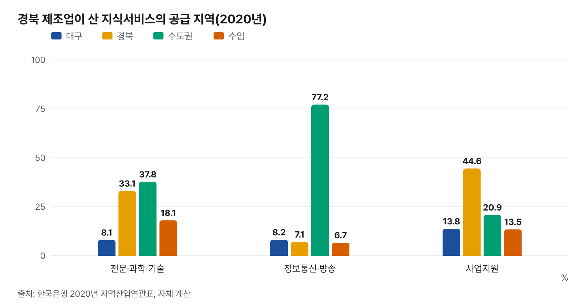

# 대구 지식서비스와 경북 첨단제조의 거래 연결 — 정책 제언 1 상세

- 「대구·경북 제조업과 서비스업 연계성 — 최신 공개 통계로 다시 계산」 Ⅷ장 제안 1을 자세히 쓴 자료
- 근거는 한국은행 「2020년 지역산업연관표」 지역간 투입산출표(33부문)·국가데이터처 전국사업체조사·인구총조사·지역소득에서 이 자료가 계산한 값. 제안 수치는 계산식을 붙였고, 공개 자료가 없는 항목은 「조사 뒤 정함」으로 두었다
- 행정통합 여부와 관계없이 대구시·경북도가 함께 또는 각자 추진할 수 있는 수단으로 적었다

## 요약

- 경북 제조업이 2020년 사들인 지식서비스(전문·과학·기술, 정보통신·방송, 사업지원) 8.74조 원 가운데 수도권(서울·경기·인천)산이 38.0%(3.33조 원), 경북산 33.0%, 수입 16.2%, 대구산 9.3%(0.81조 원)
- 정보통신·방송 서비스는 수도권산이 77.2%, 대구산 8.2%
- 대구의 지식서비스 공급 기반은 전국 대비 작음 — 2024년 종사자 입지계수 컴퓨터 프로그래밍·시스템 통합 0.42, 정보서비스 0.21, 연구개발 0.35, 엔지니어링 0.71
- 경북에는 2023 – 2024년 구미 반도체·포항 이차전지 특화단지와 기회발전특구, 대구에는 수성알파시티(디지털) 기회발전특구가 지정되었고, 2024년 12월 대경선이 구미–대구–경산을 이었다
- 제안: ① 수요·공급 조사와 연결 명단 ② 대경권 지식서비스 연결 바우처 ③ 특구·특화단지 공동 과제 ④ 산단 현장 거점 — 3년 단계 추진
- 가정 계산: 경북 제조업의 수도권산 지식서비스 구매 가운데 10%를 대구 기업이 맡으면 대구 판매 약 0.33조 원(2020년 가격), 대구 안 부가가치 유발 약 0.23조 원(대구 부문별 지역내 부가가치유발계수 적용)

## 1. 배경

- 2016년 원 보고서는 대구의 과학기술·사업·정보통신 서비스가 대경권 제조업과 떨어져 있다는 분석 결과를 냈다. 이번 재계산(2020년 표)에서도 대구·경북 네트워크의 공급자 역할 상위 부문은 사업지원·운송·금융·전문과학기술 서비스였다
- 경북 제조업 종사자 가운데 첨단·ICT 비중은 13.4%(대구 3.3%), 2020→2024년 경북 ICT 제조업 종사자 +1,631명, 중고위기술 +3,891명
- 2016년 이후 바뀐 여건
  - 2023-07 구미 반도체, 포항 이차전지(양극재) 국가첨단전략산업 특화단지 지정
  - 2024-06 기회발전특구 지정: 대구 수성알파시티(디지털)·국가산단·금호워터폴리스, 경북 포항·구미·안동·상주
  - 2024-12 대경선(구미 – 칠곡 – 대구 – 경산) 개통, 2026-02 북삼역 추가

## 2. 현황

### 경북 제조업은 서비스를 어디서 사는가(2020년)

| 서비스 | 구매액(십억 원) | 대구(%) | 경북(%) | 수도권(%) | 그 밖 시도(%) | 수입(%) |
|---|---|---|---|---|---|---|
| 도소매 및 상품중개서비스 | 7,693 | 12.7 | 15.8 | 48.3 | 19.1 | 4.0 |
| 전문, 과학 및 기술 서비스 | 6,212 | 8.1 | 33.1 | 37.8 | 2.8 | 18.1 |
| 운송서비스 | 3,731 | 6.9 | 52.8 | 24.0 | 15.1 | 1.2 |
| 금융 및 보험서비스 | 1,908 | 18.2 | 55.3 | 23.1 | 2.1 | 1.4 |
| 사업지원서비스 | 1,737 | 13.8 | 44.6 | 20.9 | 7.2 | 13.5 |
| 음식점 및 숙박서비스 | 835 | 14.5 | 48.0 | 12.1 | 21.3 | 4.1 |
| 정보통신 및 방송서비스 | 793 | 8.2 | 7.1 | 77.2 | 0.9 | 6.7 |
| 기타 서비스 | 436 | 8.8 | 60.9 | 15.6 | 3.5 | 11.3 |
| 부동산서비스 | 277 | 9.7 | 52.0 | 29.1 | 6.6 | 2.5 |
| 예술, 스포츠 및 여가 관련 서비스 | 146 | 2.9 | 51.2 | 21.9 | 23.9 | 0.1 |
| 보건 및 사회복지서비스 | 123 | 12.5 | 76.8 | 5.8 | 4.8 | 0.0 |
| 서비스 합계 | 24,045 | 10.8 | 34.3 | 36.1 | 11.0 | 7.8 |

- 경북 14개 제조 부문이 중간재로 산 서비스(생산자가격, 2020년). 수도권 = 서울·경기·인천. 구매액 1,000억 원 미만 서비스는 표에서 뺐다

### 경북 제조 부문별 지식서비스 구매처(2020년)

| 경북 제조 부문 | 지식서비스 구매(십억 원) | 대구(%) | 경북(%) | 수도권(%) | 수입(%) | 수도권산(십억 원) |
|---|---|---|---|---|---|---|
| 컴퓨터, 전자 및 광학기기 | 2,815 | 9.1 | 30.1 | 37.1 | 20.3 | 1,045 |
| 1차 금속제품 | 1,988 | 9.5 | 36.0 | 37.1 | 13.4 | 737 |
| 화학제품 | 834 | 9.2 | 32.8 | 41.8 | 13.2 | 348 |
| 운송장비 | 627 | 7.0 | 26.7 | 25.4 | 37.3 | 159 |
| 전기장비 | 507 | 8.8 | 32.1 | 38.9 | 17.3 | 197 |
| 금속가공제품 | 437 | 9.8 | 37.1 | 41.3 | 7.9 | 181 |
| 기계 및 장비 | 344 | 8.8 | 32.3 | 42.1 | 13.6 | 145 |
| 음식료품 | 317 | 10.2 | 35.9 | 46.3 | 5.3 | 147 |
| 제조임가공 및 산업용 장비 수리 | 308 | 12.5 | 42.7 | 37.0 | 2.8 | 114 |
| 비금속광물제품 | 206 | 9.9 | 36.1 | 43.8 | 6.6 | 90 |
| 섬유 및 가죽제품 | 154 | 10.2 | 33.7 | 48.2 | 5.4 | 74 |
| 목재 및 종이, 인쇄 | 111 | 10.2 | 35.7 | 45.4 | 5.6 | 51 |
| 기타 제조업제품 | 59 | 9.7 | 39.2 | 41.2 | 6.6 | 24 |
| 석탄 및 석유제품 | 34 | 10.3 | 35.5 | 36.7 | 11.9 | 13 |
| 합계 | 8,742 | 9.3 | 33.0 | 38.0 | 16.2 | 3,326 |

- 지식서비스 = 전문·과학·기술 서비스(연구개발·엔지니어링·법무회계·디자인 등), 정보통신·방송 서비스(SW·정보서비스 포함), 사업지원 서비스(인력공급·시설관리·경비도 들어 있음). 33부문 표라 세부 서비스 종류는 나눌 수 없다
- 비교: 대구 제조업의 지식서비스 구매 1.67조 원 가운데 대구산 43.6%, 수도권산 38.7%, 경북산 2.3% — 대구 제조업도 수도권 구매 비중이 경북 제조업과 비슷하다

### 대구 지식서비스는 누구에게 파는가(2020년)

| 대구 서비스 | 국내 중간재 판매(십억 원) | 대구 제조업(%) | 대구 그 밖(%) | 경북 제조업(%) | 경북 그 밖(%) | 다른 시도 제조업(%) | 다른 시도 그 밖(%) |
|---|---|---|---|---|---|---|---|
| 전문, 과학 및 기술 서비스 | 3,123 | 14.9 | 42.1 | 16.2 | 12.9 | 4.2 | 9.6 |
| 정보통신 및 방송서비스 | 808 | 4.2 | 56.2 | 8.1 | 11.4 | 1.0 | 19.2 |
| 사업지원서비스 | 3,191 | 7.1 | 51.7 | 7.5 | 14.0 | 1.8 | 17.8 |

- 대구 전문·과학·기술 서비스의 국내 중간재 판매에서 경북 제조업 몫(16.2%)은 대구 안 다른 산업(서비스·건설 등) 다음으로 크고, 대구 제조업 몫(14.9%)보다 크다

### 대구의 지식서비스 공급 기반(2024년)

| 업종(중분류) | 대구 종사자 | 대구 입지계수 | 2020→2024 증감 | 경북 종사자 | 경북 입지계수 | 2020→2024 증감 |
|---|---|---|---|---|---|---|
| 컴퓨터 프로그래밍 시스템 통합 및 관리업 | 2,844 | 0.42 | -24 | 1,424 | 0.17 | -29 |
| 정보서비스업 | 587 | 0.21 | -135 | 449 | 0.13 | -6 |
| 출판업 | 6,934 | 0.41 | 333 | 2,874 | 0.14 | 282 |
| 연구개발업 | 4,293 | 0.35 | 769 | 5,466 | 0.35 | -572 |
| 전문 서비스업 | 15,806 | 0.60 | 652 | 11,922 | 0.36 | 2,818 |
| 건축 기술 엔지니어링 및 기타 과학기술 서비스업 | 11,857 | 0.71 | 144 | 18,871 | 0.89 | 1,813 |
| 기타 전문 과학 및 기술 서비스업 | 3,790 | 0.78 | -2 | 2,689 | 0.44 | 299 |
| 사업 지원 서비스업 | 33,745 | 0.94 | 9 | 17,548 | 0.39 | -4,887 |

- 국가데이터처 전국사업체조사(등록기반). 입지계수 1 미만 = 전국보다 그 업종 종사자 비중이 작음. 출판업에는 소프트웨어 개발·공급업이 들어 있다
- 인구총조사(2020년): 대구에 사는 정보통신업 취업자 21,137명·대구에서 일하는 20,783명, 전문과학기술 33,939명·32,873명

## 3. 원인 — 확인된 것과 확인이 필요한 것

- 공개 통계로 확인된 것
  - 대구의 SW·정보서비스·연구개발 업종 종사자 비중이 전국의 0.2 – 0.4배 수준(입지계수)으로 공급 규모가 작음
  - 경북 제조업 지식서비스 구매의 38.0%가 수도권산, 16.2%가 수입 — 대구·경북 밖으로 나가는 구매가 절반 넘음
- 공개 자료로 확인할 수 없는 것(조사 뒤 정함)
  - 수도권 구매 가운데 본사 – 지방공장 사이 내부 거래(서울 본사가 공장에 제공하는 연구·전산·관리 서비스) 몫
  - 경북 제조기업이 대구 기업을 쓰지 않는 까닭(전문 분야·인력·가격·납기·보안·기존 거래 관계)
  - 대구 지식서비스 기업 가운데 제조 현장 경험이 있는 기업 수

## 4. 세부 과제

### 과제 1. 수요·공급 조사와 연결 명단

- 대상: 경북 지식서비스 구매가 큰 부문(전자·1차금속·화학)이 모인 구미·포항 산단, 대구 기업 공장이 많은 경산·칠곡 산단의 제조기업과 대구 지식서비스 기업
- 내용
  - 경북 제조기업: 외부에서 사는 지식서비스 종류(설계·시험인증·공정 데이터·SW 유지보수·보안·디자인·특허·회계), 연간 구매액, 거래처 소재지, 대구 기업을 쓰지 않는 까닭
  - 대구 공급기업: 업종·인력·제조 고객 경험·경북 고객 수. 공급 명단은 공개 명단(벤처기업명단·수성알파시티 입주기업·지원사업 수혜 이력)에서 출발
  - 결과로 「서비스 종류 × 산단」 수요표와 대구 공급기업 명단을 맞춘 연결 명단 작성(영업비밀은 공개하지 않음)
- 기간·비용: 조사 뒤 정함

### 과제 2. 대경권 지식서비스 연결 바우처

- 대상: 경북 산단 중소·중견 제조기업이 대구 소재 지식서비스 기업과 새로 맺는 계약(반대 방향 — 대구 제조기업의 경북 서비스 기업 이용 — 도 같은 틀로 열 수 있음)
- 지원: 계약액의 일부(지원율·한도는 과제 1 결과로 정함), 대구시·경북도 공동 재원
- 대상 서비스: 전문·과학·기술, 정보통신(SW·데이터·클라우드), 사업지원 중 과제 1에서 수요가 확인된 종류
- 운영: 두 시도 기업지원기관이 공동 공고, 공급기업 풀은 연결 명단 사용

### 과제 3. 특구·특화단지 공동 과제

- 대구 수성알파시티 기회발전특구(디지털) 입주 기업과 구미 반도체·포항 이차전지 특화단지 기업이 함께 신청하는 국가 R&D·실증 과제 발굴(예: 공정 데이터 분석, 품질 검사 자동화, 설비 예지보전)
- 대구 국가산단 기회발전특구(첨단제조)의 시험·인증 장비를 경북 협력사도 쓸 수 있게 공동 이용 안내
- 과제 주제와 참여 기업은 과제 1 수요표로 정함

### 과제 4. 산단 현장 거점

- 대구 서비스 기업이 경북 산단 고객사를 상주·방문 지원할 수 있는 공동 사무공간(구미 등) 검토
- 대경선 역(구미·북삼·왜관·경산)과 산단 사이 이동 시간을 함께 조사해 위치를 정함
- 필요성·규모는 과제 1·2 결과를 보고 정함

## 5. 기대효과(가정 계산)

- 가정: 경북 제조업의 수도권산 지식서비스 구매(3,326십억 원, 2020년) 가운데 일정 몫을 대구 기업이 맡음

| 대구로 옮겨 오는 몫 | 대구 판매 증가(십억 원) | 대구 안 부가가치 유발(십억 원) | 취업 유발(명, 전국 계수 참고) |
|---|---|---|---|
| 5% | 166 | 116 | 1,647 |
| 10% | 333 | 231 | 3,295 |
| 20% | 665 | 463 | 6,589 |

- 계산식: 대구 판매 = 서비스별 수도권산 구매 × 몫. 부가가치 = 판매 × 대구 지역내 부가가치유발계수(전문·과학·기술 0.6913, 정보통신·방송 0.6768, 사업지원 0.7538, 한국은행 2020년 지역산업연관표). 취업 = 판매(십억 원) × 전국 취업유발계수(9.8·8.0·13.8명, 한국은행 2020년 고용표) — 대구 업종별 계수가 공개되지 않아 전국 계수를 참고로만 씀
- 유발계수는 최종수요 1단위 기준이라 중간재 판매 증가에 그대로 쓰면 근사다. 경북·수도권 쪽 감소분과 2020년 이후 가격 변화는 넣지 않았다

## 6. 추진 일정(안)

| 단계 | 기간 | 내용 | 확인 지표 |
|---|---|---|---|
| 1단계 | 1년차 | 과제 1 수요·공급 조사, 연결 명단, 바우처 설계 | 조사 응답 기업 수, 연결 명단 기업 수 |
| 2단계 | 2년차 | 과제 2 바우처 시범(산단 1 – 2곳), 과제 3 공동 과제 발굴 | 바우처 계약 건수·금액, 공동 과제 신청 수 |
| 3단계 | 3년차 | 바우처 확대 여부 결정, 과제 4 현장 거점 검토 | 재계약 비율, 대구 지식서비스 입지계수 |

## 7. 추적 지표

- 지역산업연관표(5년 주기): 경북 제조업 지식서비스 구매 중 대구산 비중(2020년 9.3%)
- 전국사업체조사(매년): 대구 컴퓨터 프로그래밍·정보서비스·연구개발·엔지니어링 종사자와 입지계수
- 지역소득(매년): 대구 정보통신업·전문과학기술 서비스업 부가가치 비중과 입지계수
- 사업 자료: 바우처 계약 건수·금액·재계약 비율

## 8. 한계

- 산업연관표는 2020년(코로나19 첫해) 값이고 33부문이라 세부 서비스(예: SW 개발과 데이터 처리)를 나눌 수 없다
- 수도권 구매에는 본사 – 공장 내부 거래가 섞여 있을 수 있어, 그 몫은 대구 기업이 맡기 어렵다(규모는 과제 1 조사로 확인)
- 가정 계산의 몫(5 – 20%)은 목표가 아니라 크기를 보이기 위한 예시다

## 출처

- 한국은행 「2020년 지역산업연관표」 지역간 투입산출표(생산자가격, 통합대분류 33부문)·부가가치유발계수, 「2020년 고용표」 취업유발계수
- 국가데이터처 전국사업체조사(등록기반, 2020·2024년), 인구총조사(2020년), 지역소득
- 특화단지·기회발전특구·대경선: 산업통상자원부·지방시대위원회 지정, 보도(2024-06 ~ 2026-02)
- 계산 스크립트: scripts/dg_linkage_io.py, scripts/dg_linkage_stats.py, scripts/dg_linkage_p1.py(다잇다 저장소)
